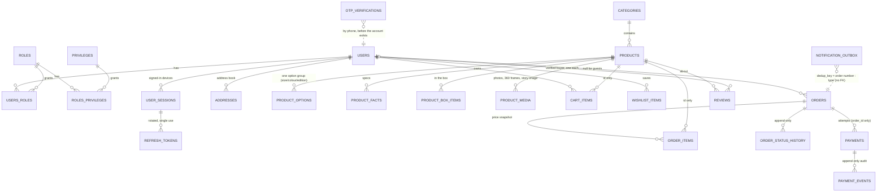

# ERD

**Source of truth:** `ecommerce-api/src/main/resources/db/migration/V1..V10`. Hibernate only
validates against it (`ddl-auto=validate`). Every table except the small child/seed tables
carries the audit columns `created_by, last_modified_by, creation_date, last_modified_date`.

## Module ownership (a table is written by exactly one module)

| Module | Tables |
|---|---|
| `ecommerce-user` | `users`, `roles`, `privileges`, `users_roles`, `roles_privileges`, `user_sessions`, `refresh_tokens`, `otp_verifications`, `addresses` |
| `ecommerce-catalog` | `categories`, `products`, `product_options`, `product_facts`, `product_box_items`, `product_media`, `characters` and `product_tags` (V8), `product_bundle_items` and `early_access_signups` (V9), `product_view_daily` and `search_term_daily` (V10) |
| `ecommerce-cart` | `cart_items`, `wishlist_items` |
| `ecommerce-payment` | `payments`, `payment_events` (taken over from order in V6) |
| `ecommerce-notification` | `notification_outbox` (V7) |
| `ecommerce-order` | `orders`, `order_items`, `order_status_history` |
| `ecommerce-review` | `reviews` |
| `ecommerce-insights` | none: reads `CatalogReport`, `DemandReport` and `SalesReport` |

Cross-module links (`cart_items.product_id`, `order_items.product_id`, `orders.user_id`,
`reviews.product_id`) are plain id fields in Java but real foreign keys in PostgreSQL.

## Rules the schema enforces

| Rule | How |
|---|---|
| Every account can sign in | `users_has_sign_in`: phone, or email + password hash |
| Emails are compared case-insensitively | `users_email_lowercase` + code lowercases |
| One default address per user | Partial unique index `addresses_one_default` |
| No negative stock | `CHECK (stock >= 0)` on products and options |
| A pre-order has a release month and deposit | `products_preorder_fields` |
| One cart line per product + option | `UNIQUE NULLS NOT DISTINCT (user_id, product_id, option_id)` (PostgreSQL 15+) |
| Totals add up | `orders_total_adds_up`, `line_total = unit_price * quantity` |
| A retried checkout cannot create a second order | `orders.idempotency_key UNIQUE` |
| Status history and payment events are never edited | `BEFORE UPDATE` triggers raise |
| One row per vendor payment | Partial unique index on `(provider, provider_payment_id)`; `payments.reference` unique |
| An email is queued once per order event | `notification_outbox.dedup_key UNIQUE` |
| One review per buyer per product | `reviews_one_per_buyer` |
| Removing a product option never breaks history | `order_items.option_id ON DELETE SET NULL` (label is snapshotted); cart lines cascade |

## Stock rule

A product without options sells from `products.stock`. A product with options sells from
each `product_options.stock`, and `products.stock` holds their sum so lists can filter and
sort on one column (`Product.recomputeStock()`; reservations decrement both atomically).
